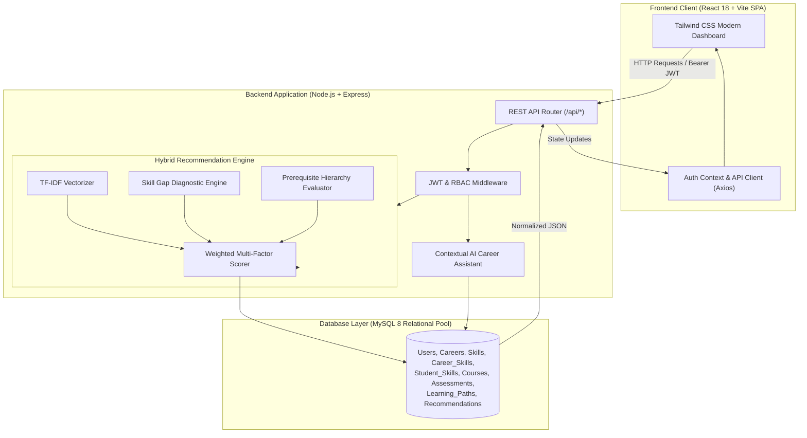

# 🚀 SkillPath AI — AI-Based Personalized Learning Path Recommendation Engine

[](https://react.dev/)
[](https://nodejs.org/)
[](https://www.mysql.com/)
[](https://tailwindcss.com/)
[](LICENSE)

> **SkillPath AI** is an intelligent, full-stack educational platform designed to bridge the gap between academic knowledge and industry career demands. By evaluating a student's current technical competencies against benchmark requirements for 23 career roles, SkillPath AI diagnoses skill gaps, eliminates redundant learning, and synthesizes a custom, 5-phase adaptive learning roadmap powered by an explainable hybrid recommendation algorithm.

---

## 📑 Table of Contents

- [Executive Summary](#-executive-summary)
- [System Highlights & Key Features](#-system-highlights--key-features)
- [Hybrid AI Recommendation Engine](#-hybrid-ai-recommendation-engine)
- [System Architecture & Workflow](#-system-architecture--workflow)
- [Technology Stack](#-technology-stack)
- [Database Architecture & Entities](#-database-architecture--entities)
- [Application Pages & Routes](#-application-pages--routes)
- [REST API Reference](#-rest-api-reference)
- [Getting Started & Installation](#-getting-started--installation)
- [Default Demo Credentials](#-default-demo-credentials)
- [Testing & Quality Assurance](#-testing--quality-assurance)
- [Project Directory Structure](#-project-directory-structure)
- [Future Roadmap](#-future-roadmap)
- [License](#-license)

---

## 🎯 Executive Summary

Traditional curriculum models follow a "one-size-fits-all" approach, often forcing learners to sit through concepts they already know or leaving them confused when faced with missing prerequisites. 

**SkillPath AI solves this through intelligent personalization:**
1. **Accurate Skill Diagnostics**: Identifies which skills you have mastered, which are partially known, and which are completely missing.
2. **Zero Redundant Relearning**: Mastered topics are filtered out of required modules; focus is strictly directed to target gaps.
3. **Adaptive Sequencing**: Modules are dynamically ordered using a directed prerequisite hierarchy so students never encounter advanced topics before fundamentals.
4. **Explainable AI Recommendations**: Every suggestion comes with transparent mathematical scoring and natural language justification.

---

## ✨ System Highlights & Key Features

### 1. 23 Comprehensive Industry Career Roles Across 5 Domains
Benchmarks cover standard industry requirements across modern engineering disciplines:
- 🌐 **Web & Software Development**: Frontend Developer, Backend Developer, Full Stack Developer, Java Developer, Python Developer, Software Engineer, Mobile App Developer.
- 🤖 **Data & Artificial Intelligence**: Data Analyst, Data Scientist, Machine Learning Engineer, AI Engineer, Generative AI Developer, Data Engineer.
- ☁️ **Cloud & Infrastructure**: DevOps Engineer, Cloud Engineer, Site Reliability Engineer.
- 🛡️ **Security & Quality Engineering**: Cybersecurity Analyst, Ethical Security Testing Learner, Software Test Engineer, Automation Test Engineer.
- 🎨 **Systems & Design**: Database Administrator, UI/UX Designer, Business Intelligence Developer.

---

### 2. Zero-Redundancy Skill Gap Diagnostics
When a student selects a career or takes an assessment, skills are categorized into three distinct operational buckets:
- 🟢 **Mastered Skills** ($\ge \text{target benchmark}$): Already confirmed; marked as completed. The engine will **never** force you to relearn what you already know.
- 🟡 **Partially Known Skills** ($0 < \text{score} < \text{target}$): Foundational knowledge verified; custom advanced revision topics and targeted practice are recommended.
- 🔴 **Missing Skills** ($\text{score} = 0$): Required competencies needing complete end-to-end guidance from core fundamentals.

---

### 3. 5-Phase Adaptive Learning Roadmap
Sequenced logically via prerequisite trees to ensure optimal cognitive progression:
- **Phase 1: Core Fundamentals & Prerequisite Foundations**: Core programming syntax, data structures, and runtime essentials.
- **Phase 2: Primary Tech Stack Mastery & Architecture**: Core frameworks, state management, API design, and asynchronous patterns.
- **Phase 3: Database Design, Storage & Optimization**: Relational & NoSQL modeling, query optimization, indexing, and transactional integrity.
- **Phase 4: Professional Tooling, Security & Testing**: Version control workflows, automated testing, containerization, and authentication/authorization.
- **Phase 5: Production Deployment, Scalability & Capstone Projects**: Cloud hosting, CI/CD pipelines, system monitoring, and portfolio project delivery.

---

### 4. Context-Aware AI Career & Learning Assistant
An interactive learning copilot with full awareness of the student's active target role, proficiency levels, and completed roadmap milestones.
- Instant contextual advice: *"What should I learn next?"*, *"Can I transition to DevOps from Backend?"*, *"What project can I build to demonstrate Docker?"*
- Follow-up explanations for quiz mistakes and curriculum guidance.

---

### 5. Automated Skill Assessments & Quizzes
- Pre-assessment diagnostic tests to calibrate initial skill scores.
- End-of-module interactive quizzes that dynamically recalibrate proficiency in the database and re-evaluate roadmap step unlock statuses.

---

### 6. Student Portfolio Tracker & Curated Resources
- **Project Showcase**: Track personal GitHub repositories, live deployment links, and tech stacks used.
- **Curated Documentation Directory**: Direct, verified links to official documentation (MDN, Node.js, React, Docker, Python, etc.) avoiding outdated tutorials.

---

### 7. Full Admin Management Portal
- **System Analytics**: Platform-wide KPIs on enrolled students, popular careers, and completion rates.
- **CMS Management**: Direct CRUD interfaces for careers, skills, courses, modules, and diagnostic assessment questions.

---

## 🧠 Hybrid AI Recommendation Engine

The recommendation engine utilizes a multi-factor hybrid algorithm combining content-based filtering (TF-IDF metadata vectorization) and deterministic rule-based heuristic scoring.

### Scoring Formula

For any candidate course or skill $C$ evaluated for student $S$:

$$\text{Recommendation Score} = \sum_{i=1}^{5} w_i \cdot S_i = w_1 S_{\text{gap}} + w_2 S_{\text{prereq}} + w_3 S_{\text{relevance}} + w_4 S_{\text{perf}} + w_5 S_{\text{diff}}$$

### Weight Matrix Configuration (`backend/src/config/recommendationConfig.js`):

| Weight | Parameter | Value | Purpose |
|:---:|:---|:---:|:---|
| $w_1$ | **$S_{\text{gap}}$ (Skill Gap Score)** | `0.30` | Prioritizes skills where the student has the largest discrepancy relative to the role benchmark. |
| $w_2$ | **$S_{\text{prereq}}$ (Prerequisite Match)** | `0.25` | Ensures foundational dependencies are fulfilled prior to recommending advanced courses. |
| $w_3$ | **$S_{\text{relevance}}$ (TF-IDF Similarity)** | `0.20` | Measures cosine similarity between role domain vectors and course syllabus descriptions. |
| $w_4$ | **$S_{\text{perf}}$ (Historical Performance)** | `0.15` | Factors in recent quiz and diagnostic test scores to identify if remediation is required. |
| $w_5$ | **$S_{\text{diff}}$ (Difficulty Fit)** | `0.10` | Matches student's current proficiency tier (Beginner/Intermediate/Advanced) with course level. |

### Mathematical Breakdown of Components:
- **Skill Gap ($S_{\text{gap}}$)**: $\max(0, \text{Required Proficiency} - \text{Current Proficiency})$
- **Prerequisite Satisfaction ($S_{\text{prereq}}$)**: Calculated by traversing the Directed Acyclic Graph (DAG) of prerequisites; penalized if dependencies are unmet.
- **Relevance ($S_{\text{relevance}}$)**: $\text{Cosine Similarity}(\vec{V}_{\text{career}}, \vec{V}_{\text{course}})$ computed via term frequency-inverse document frequency over technical syllabi.
- **Explainability**: Outputs a plain-English reason string alongside numerical scores (e.g., *"Recommended because this directly targets your largest skill gap in Docker (65% gap) and all prerequisite Linux fundamentals are complete"*).

---

## 🏗 System Architecture & Workflow



### System Data Flow:
1. **Onboarding & Calibration**: The student registers, selects an initial career goal or interests, and registers their known competencies (or takes a diagnostic quiz).
2. **Diagnostic Evaluation**: The backend computes exact gaps per skill: $\text{Gap} = \max(0, \text{Benchmark} - \text{Current})$.
3. **Graph Resolution**: Prerequisite graphs are resolved to assign priority and chronological phases.
4. **Adaptive Delivery**: Roadmaps, courses, and resources are rendered. When a student completes a milestone, scores recalculate automatically.

---

## 💻 Technology Stack

### Frontend
- **Framework**: [React 18](https://react.dev/) (Single Page Application architecture)
- **Build Tool**: [Vite](https://vitejs.dev/) (Lightning-fast HMR and bundle optimization)
- **Styling**: [Tailwind CSS](https://tailwindcss.com/) (Responsive, enterprise-grade design tokens)
- **Icons & Graphics**: [Lucide React](https://lucide.dev/)
- **Charts & Data Visualization**: [Recharts](https://recharts.org/) (Interactive radar and bar charts for skill benchmarks)
- **Routing**: [React Router v6](https://reactrouter.com/) (Protected routes, role-based guard rails)
- **Network Layer**: [Axios](https://axios-http.com/) (Centralized interceptors for JWT tokens)

### Backend
- **Runtime**: [Node.js](https://nodejs.org/) (LTS)
- **Web Framework**: [Express.js](https://expressjs.com/) (RESTful design, modular routers)
- **Authentication**: [JSON Web Tokens (JWT)](https://jwt.io/) & [bcryptjs](https://github.com/dcodeIO/bcrypt.js)
- **Input Validation**: [express-validator](https://express-validator.github.io/docs/)
- **Environment Management**: [dotenv](https://github.com/motdotla/dotenv)
- **CORS Support**: [cors](https://github.com/expressjs/cors)

### Database
- **Engine**: [MySQL 8.0+](https://www.mysql.com/)
- **Driver**: [mysql2](https://github.com/sidorares/node-mysql2) (Connection pooling with async/await Promises)
- **Integrity**: Strict foreign key constraints, composite primary keys, and indexed lookups.

---

## 🗄 Database Architecture & Entities

The relational database (`learning_path_db`) is fully normalized to 3NF. Key tables include:

```
├── users                      # Base account credentials (id, email, password_hash, role)
├── student_profiles           # Academic status, graduation year, target career ID
├── student_preferences        # Preferred learning pace, weekly hours, timeframe
├── careers                    # Catalog of 23 target industry roles
├── skills                     # Catalog of 60+ technical competencies
├── career_skills              # Required benchmark proficiencies (0-100) and weights per career
├── skill_prerequisites        # Hierarchical DAG dependencies between skills
├── student_skills             # Assessed proficiency matrix (0-100) per student
├── courses                    # Curated courses aligned with target skills
├── course_prerequisites       # Course prerequisite requirements
├── modules & lessons          # Course syllabus breakdowns
├── assessments & questions    # Benchmark tests for skill validation
├── assessment_attempts        # Historical student test submissions & grades
├── learning_paths             # Generated roadmap parent instances
├── learning_path_items        # Individual ordered milestone roadmap steps
└── recommendations            # Cached top scoring recommendations with explanations
```

---

## 🌐 Application Pages & Routes

### Public Pages
| Path | Component | Purpose |
|:---|:---|:---|
| `/` | `Landing.jsx` | Platform landing page with domain showcase and value propositions |
| `/login` | `Login.jsx` | Secure login with role-based redirection |
| `/register` | `Register.jsx` | Student onboarding registration with academic details |

### Student Portal (Protected)
| Path | Component | Purpose |
|:---|:---|:---|
| `/onboarding` | `Onboarding.jsx` | 4-step wizard: education level, current skills, domain interests, and learning pace |
| `/dashboard` | `Dashboard.jsx` | Central dashboard: top recommended roles, summary statistics, weekly study hours, next step |
| `/recommendations` | `Recommendations.jsx` | Top role matches with compatibility scores (e.g. 85%, 75%), missing skills, and prep times |
| `/skill-gap` | `SkillGap.jsx` | Visual gap diagnostics (Mastered, Partial, Missing) against industry benchmarks |
| `/roadmap` | `LearningPathPage.jsx` | Dynamic 5-phase sequential learning path with completion checkboxes |
| `/roles` | `ExploreRoles.jsx` | Searchable directory of 23 career roles across 5 domain tabs with filtering |
| `/roles/:id` | `RoleDetails.jsx` | Role breakdown: benchmark skills, prerequisite paths, and "Set as Target Goal" CTA |
| `/assistant` | `AiAssistant.jsx` | Interactive AI career assistant with contextual quick-prompt chips |
| `/resources` | `LearningResources.jsx` | Curated documentation directory (MDN, Node.js, freeCodeCamp, Docker, etc.) |
| `/projects` | `ProjectsAssessments.jsx`| Portfolio manager (GitHub repository/Demo URLs) & skill benchmark quizes |
| `/courses/:id` | `CourseDetails.jsx` | Detailed course overview, syllabus modules, and enrollment |
| `/courses/:id/learn` | `CoursePlayer.jsx` | Interactive lesson player with video links and completion buttons |
| `/assessments/:id` | `Assessment.jsx` | 10-question skill assessment with instant automated proficiency recalculation |
| `/profile` | `Profile.jsx` | Student profile, target career selection, and technical skill manager |

### Admin Portal (Role-Guarded: `admin`)
| Path | Component | Purpose |
|:---|:---|:---|
| `/admin` | `AdminDashboard.jsx` | High-level metrics: total students, popular career paths, platform engagement |
| `/admin/students` | `AdminStudents.jsx` | Directory of enrolled students, progress statuses, and accounts |
| `/admin/careers` | `AdminCareers.jsx` | Manage career roles, required skills, and benchmark weights |
| `/admin/skills` | `AdminSkills.jsx` | Add, modify, or categorize technical skills |
| `/admin/courses` | `AdminCourses.jsx` | Manage courses, modules, lessons, and prerequisites |

---

## 🔌 REST API Reference

All protected endpoints require an `Authorization: Bearer <JWT_TOKEN>` header.

### Authentication (`/api/auth`)
- `POST /api/auth/register` — Register student account (`fullName`, `email`, `password`, `educationLevel`).
- `POST /api/auth/login` — Login user; returns signed JWT and user profile.
- `GET /api/auth/me` — Retrieve current authenticated session user.

### Student Management (`/api/students`)
- `GET /api/students/profile` — Get profile, academic info, and target career.
- `PUT /api/students/profile` — Update target role and study preferences.
- `GET /api/students/skills` — Get student's current proficiency matrix.
- `PUT /api/students/skills` — Batch update skill ratings and self-assessments.
- `GET /api/students/progress` — Get aggregated completion statistics.

### Careers & Skills (`/api/careers`, `/api/skills`)
- `GET /api/careers` — List all 23 career pathways.
- `GET /api/careers/:id` — Get detailed career requirements, benchmarks, and skills.
- `GET /api/skills` — List all technical skills in the catalog.

### Recommendations & Roadmaps (`/api/recommendations`, `/api/learning-path`)
- `GET /api/recommendations` — Fetch ranked career and course recommendations with hybrid scores.
- `GET /api/recommendations/next` — Fetch top single next actionable module or skill.
- `POST /api/recommendations/refresh` — Recalculate recommendation rankings.
- `GET /api/learning-path` — Fetch student's active 5-phase learning roadmap.
- `POST /api/learning-path/generate` — Regenerate roadmap based on updated skills.
- `PUT /api/learning-path/items/:id` — Toggle roadmap milestone completion state.

### AI Assistant & Support (`/api/assistant`)
- `POST /api/assistant/chat` — Send query to contextual AI assistant (`query`, `history`).

### Assessments & Quizzes (`/api/assessments`, `/api/quizzes`)
- `GET /api/assessments` — List available diagnostic assessments.
- `GET /api/assessments/:id` — Fetch assessment questions (answers withheld).
- `POST /api/assessments/:id/submit` — Submit answers; auto-grades and updates skill scores in MySQL.
- `POST /api/quizzes/:id/submit` — Submit course lesson quiz answers.

### Admin Operations (`/api/admin`)
- `GET /api/admin/analytics` — Platform KPI aggregates.
- `GET /api/admin/students` — Student accounts directory.
- `POST /api/admin/careers` — Create or update career pathway.
- `POST /api/admin/skills` — Create or update skill entity.
- `POST /api/admin/courses` — Create course and syllabus modules.

---

## ⚡ Getting Started & Installation

### Prerequisites
- **Node.js**: `v18.0.0` or higher ([Download Node.js](https://nodejs.org/))
- **MySQL**: `8.0` or higher ([Download MySQL](https://dev.mysql.com/downloads/mysql/))
- **Git**: Installed and configured on your system

---

### Step 1: Clone the Repository
```bash
git clone https://github.com/Ukash-07/Mini-Project-Skill-Path-AI.git
cd Mini-Project-Skill-Path-AI
```

---

### Step 2: Configure Environment Variables
Navigate into `backend/` and copy `.env.example` to `.env`:
```bash
cd backend
cp .env.example .env
```
*(On Windows PowerShell: `Copy-Item .env.example .env`)*

Open `backend/.env` and configure your local MySQL credentials:
```env
PORT=5000
DB_HOST=localhost
DB_PORT=3306
DB_USER=root
DB_PASSWORD=your_mysql_root_password
DB_NAME=learning_path_db
DB_SSL=false
JWT_SECRET=super_secret_jwt_key_skillpath_2026
NODE_ENV=development
```

---

### Step 3: Install Backend Dependencies & Seed Database
From the `backend/` directory:
```bash
npm install
npm run db:setup
```
> **What this does:**
> 1. Connects to your MySQL server.
> 2. Creates the `learning_path_db` database if it doesn't already exist.
> 3. Executes `database/schema.sql` to establish all tables, relations, and indexes.
> 4. Seeds 23 industry career pathways, 60+ skills, course modules, benchmark quizzes, and demo accounts.

---

### Step 4: Start the Backend Server
```bash
npm run dev
```
The API server will start on: **`http://localhost:5000`**  
Verify health by visiting: `http://localhost:5000/api/health`

---

### Step 5: Install Frontend Dependencies & Start Client
Open a new terminal window, navigate to the `frontend/` directory:
```bash
cd frontend
npm install
npm run dev
```
The client will launch at: **`http://localhost:3000`** (or `http://localhost:5173` depending on port availability).

---

## 🔐 Default Demo Credentials

Pre-seeded accounts are immediately available for testing:

| Role | Email | Password | Access Level |
|:---|:---|:---|:---|
| **Student** | `student@learningpath.ai` | `Student@12345` | Student Dashboard, Skill Gap, 5-Phase Roadmap, AI Assistant, Assessments |
| **System Admin** | `admin@learningpath.ai` | `Admin@12345` | Admin Portal (`/admin`), Student Roster, CMS for Careers, Skills, Courses |

*You can also register a new student account to experience the 4-step onboarding wizard from scratch.*

---

## 🧪 Testing & Quality Assurance

To execute automated unit and integration tests for the recommendation engine and scoring algorithms:
```bash
cd backend
npm test
```
This tests:
- Hybrid scoring formula normalization ($0 - 100$).
- Prerequisite DAG resolution and penalty calculations.
- TF-IDF content similarity edge cases.
- Skill gap diagnostic categorization logic.

---

## 📂 Project Directory Structure

```
mini-project/
├── backend/
│   ├── src/
│   │   ├── config/              # Central configurations (recommendationConfig.js, db.js)
│   │   ├── controllers/         # Request handling & business logic (auth, student, career, etc.)
│   │   ├── middleware/          # JWT auth middleware, role verification, error handlers
│   │   ├── routes/              # Express API route declarations
│   │   ├── services/            # Recommendation engine, TF-IDF, gap analysis, AI assistant
│   │   ├── app.js               # Express app mounting, CORS & global middleware
│   │   └── server.js            # Entry point listening on PORT 5000
│   ├── tests/                   # Automated test suites
│   ├── .env.example             # Template for backend environment variables
│   └── package.json
│
├── frontend/
│   ├── src/
│   │   ├── components/          # Reusable UI components (Navbar, Sidebar, CourseCard, etc.)
│   │   ├── context/             # Global AuthContext & state providers
│   │   ├── pages/               # Main application pages (Dashboard, Roadmap, SkillGap, etc.)
│   │   │   └── admin/           # Administrative portal views (AdminDashboard, AdminCareers, etc.)
│   │   ├── services/            # Axios API clients for backend communication
│   │   ├── App.jsx              # Application routing & protected route definitions
│   │   ├── index.css            # Tailwind CSS directives & global styling
│   │   └── main.jsx             # React DOM root render
│   ├── index.html               # Main HTML entry
│   ├── tailwind.config.js       # Tailwind CSS configuration
│   ├── vite.config.js           # Vite dev server configuration
│   └── package.json
│
├── database/
│   ├── schema.sql               # Normalized DDL table definitions
│   └── setup.js                 # Automatic database creation & data seeding script
│
├── docs/                        # In-depth architectural & API documentation
│   ├── api.md                   # Complete REST endpoint specifications
│   ├── architecture.md          # System architecture & sequence flow
│   ├── database.md              # Database schema entity documentation
│   └── recommendation-engine.md # Detailed mathematical formulation of hybrid scorer
│
└── README.md                    # Primary project documentation
```

---

## 🔮 Future Roadmap

- [ ] **LLM Integration**: Direct connection with Gemini API for live natural language feedback on code exercises.
- [ ] **Resume / CV Parsing**: Upload PDF resumes to automatically extract and populate current skills using NLP.
- [ ] **Coding Sandbox**: Embedded in-browser code execution runtime for JavaScript, Python, and SQL practice.
- [ ] **Peer Mentorship**: Collaborative group study roadmaps and milestone sharing.

---

## 📄 License

This project is licensed under the **MIT License**. Feel free to use, modify, and distribute for educational and non-commercial purposes.
